<div align="center">

# OpenTraderWorld

**Your trading workspace, on your own machine.**

[](https://opentraderworld.com)
[](LICENSE)
[](https://g-otw.github.io/OpenTraderWorld/)
[](https://g-otw.github.io/OpenTraderWorld/guide/install)

A free, self-hosted platform that bundles the tools traders and investors use every day:
journal, charts, backtesting, portfolios, news and research. Your data stays on your machine,
and your own AI agent can run it alongside you.

[**Live demo**](https://demo.opentraderworld.com) ·
[Install](#quick-start) ·
[Documentation](https://g-otw.github.io/OpenTraderWorld/) ·
[Website](https://opentraderworld.com) ·
[Suggest a feature](https://opentraderworld.com/suggestions)

<picture>
  <source media="(prefers-color-scheme: dark)" srcset="docs/public/screenshots/charts-dark.gif">
  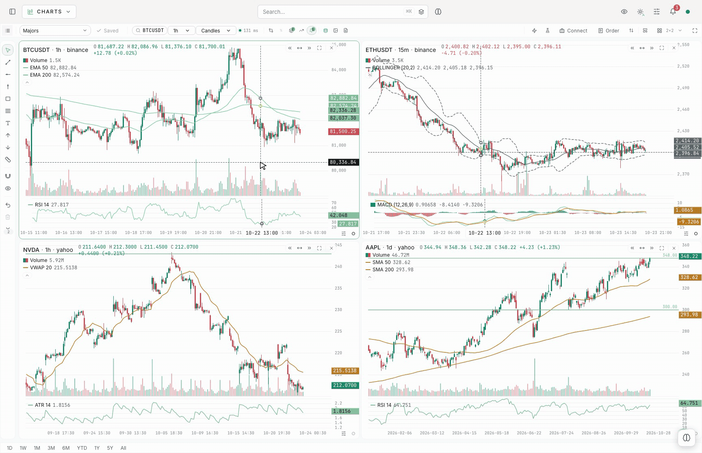
</picture>

</div>

## Contents

- [Why OpenTraderWorld](#why-opentraderworld)
- [Screenshots](#screenshots)
- [Modules](#modules)
- [Data and brokers](#data-and-brokers)
- [Quick start](#quick-start)
- [Upgrading](#upgrading)
- [Architecture](#architecture)
- [Community](#community)
- [Disclaimer](#disclaimer)
- [License](#license)

## Why OpenTraderWorld

A Bloomberg Terminal costs about $30,000 a year, and what it sells is access, not screens.
OpenTraderWorld does not try to be the next one. It is the workspace around your own decisions,
with the data providers you already pay for, or the free ones.

- **Free.** No subscription, no paywall, no pro tier.
- **Private.** Runs on your computer or server with Docker. No account, no cloud, no telemetry.
  Answers on localhost only until you open it up.
- **Modular.** 25+ modules. Keep what you use, detach the rest.
- **AI on your terms.** A built-in [agent](https://g-otw.github.io/OpenTraderWorld/modules/agent)
  with your own provider, and an [MCP server](https://g-otw.github.io/OpenTraderWorld/config/ai-agents)
  for external agents. Both off until you turn them on, scoped by token.
- **Automated, under your control.** Scheduled [workflows](https://g-otw.github.io/OpenTraderWorld/modules/automator)
  for imports, reports, scans and alerts. Nothing runs or sends unless you switched it on.
- **Secrets sealed.** Credentials sit in an encrypted [Vault](https://g-otw.github.io/OpenTraderWorld/config/settings#vault),
  write-only once saved and never sent to the browser.
- **7 languages.** English, French, German, Spanish, Italian, Portuguese, Chinese.

## Screenshots

Captured from a local install. Prices, news and backtests are real; journal, portfolio and
fundamentals figures are sample data.

<table>
<tr>
<td width="50%" valign="top">
<picture>
  <source media="(prefers-color-scheme: dark)" srcset="docs/public/screenshots/dashboard-dark.gif">
  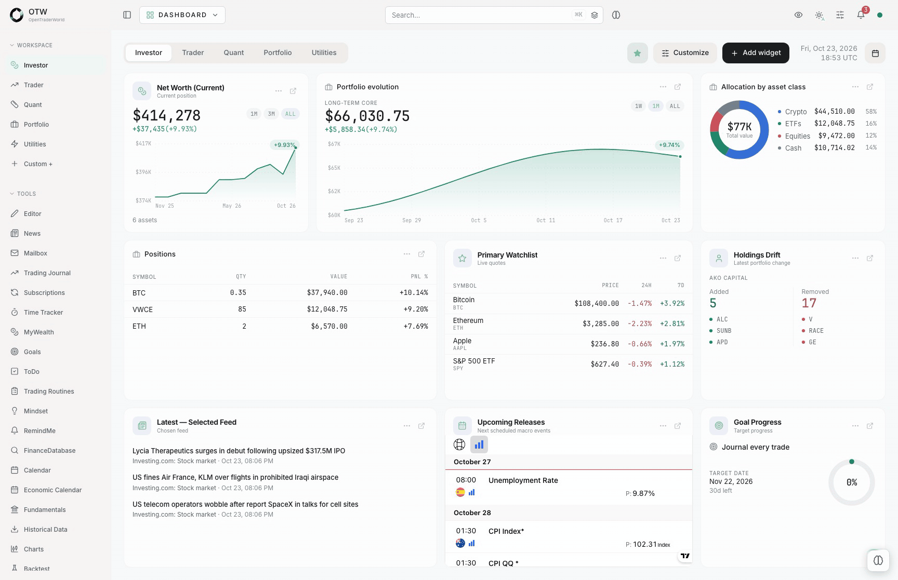
</picture>
<b>Dashboard</b>: one workspace per hat you wear, built from widgets.
</td>
<td width="50%" valign="top">
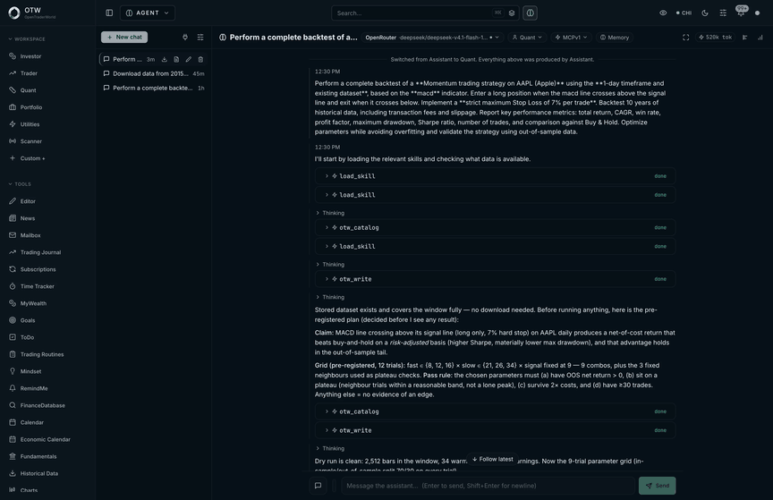
<b>Agent</b>: a 10-year backtest asked in plain language, run end to end.
</td>
</tr>
<tr>
<td valign="top">
<picture>
  <source media="(prefers-color-scheme: dark)" srcset="docs/public/screenshots/backtest-dark.gif">
  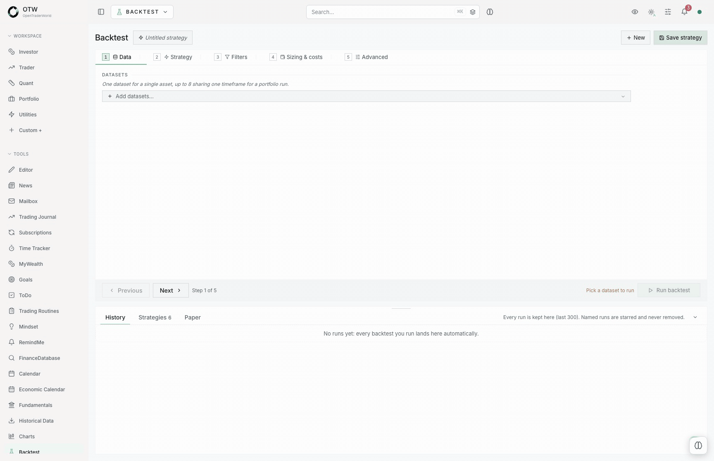
</picture>
<b>Backtest</b>: every trade on the chart, measured against buy and hold.
</td>
<td valign="top">
<picture>
  <source media="(prefers-color-scheme: dark)" srcset="docs/public/screenshots/journal-dark.png">
  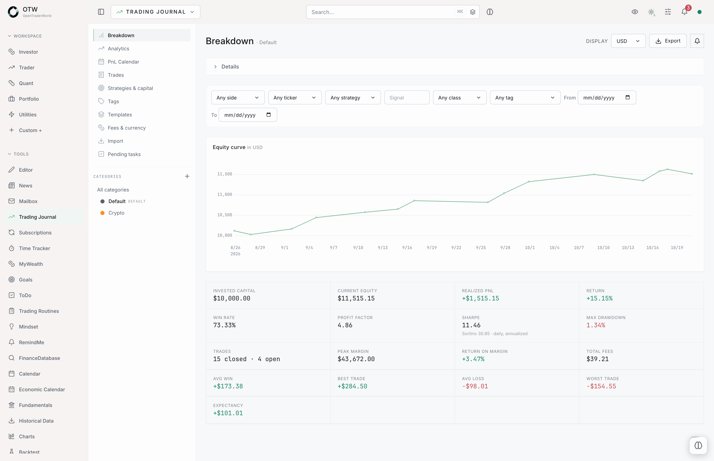
</picture>
<b>Trading Journal</b>: equity curve, win rate, R-multiples, behaviour patterns.
</td>
</tr>
<tr>
<td valign="top">
<picture>
  <source media="(prefers-color-scheme: dark)" srcset="docs/public/screenshots/portfolio-dark.png">
  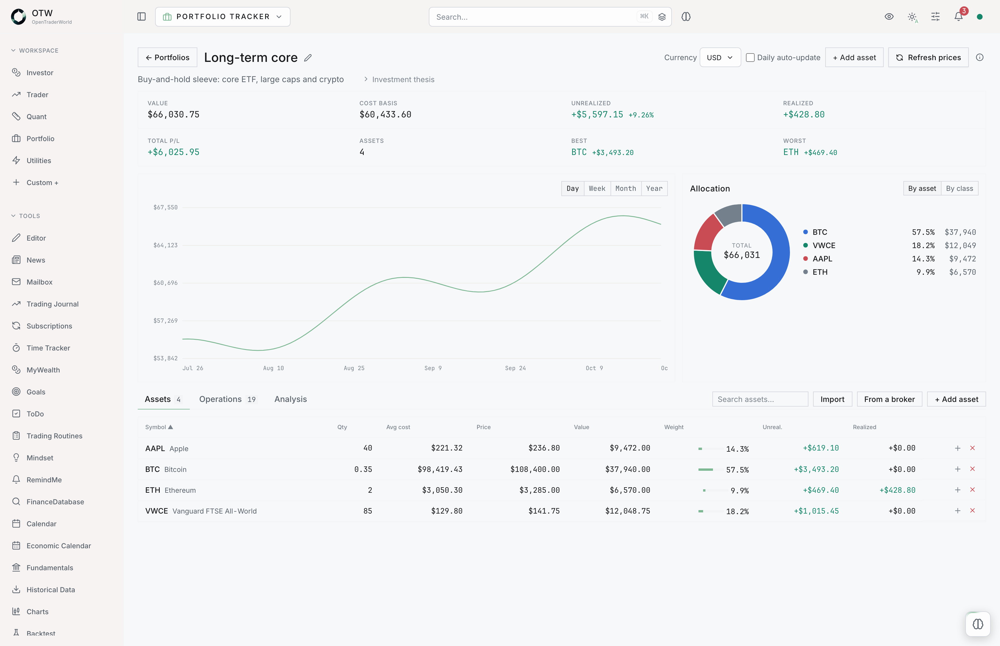
</picture>
<b>Portfolio Tracker</b>: holdings priced daily, P/L, allocation, full ledger.
</td>
<td valign="top">
<picture>
  <source media="(prefers-color-scheme: dark)" srcset="docs/public/screenshots/quant-dark.png">
  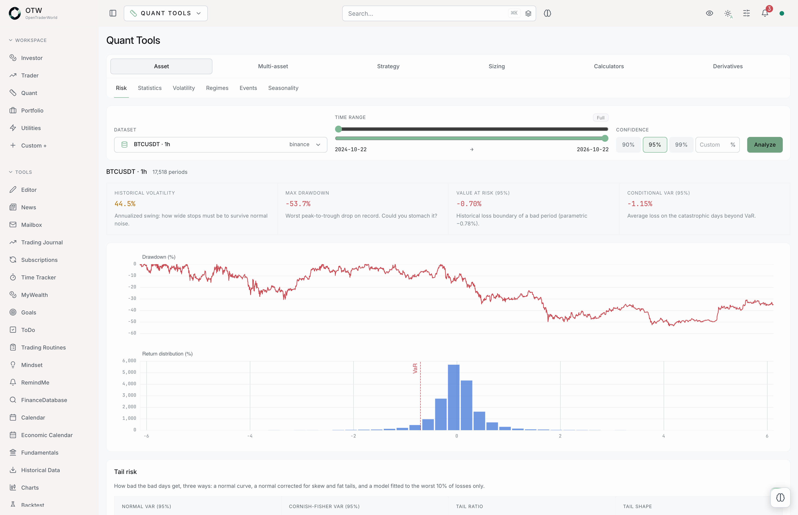
</picture>
<b>Quant Tools</b>: volatility, drawdown, VaR, correlation, efficient frontier.
</td>
</tr>
<tr>
<td valign="top">
<picture>
  <source media="(prefers-color-scheme: dark)" srcset="docs/public/screenshots/fundamentals-dark.png">
  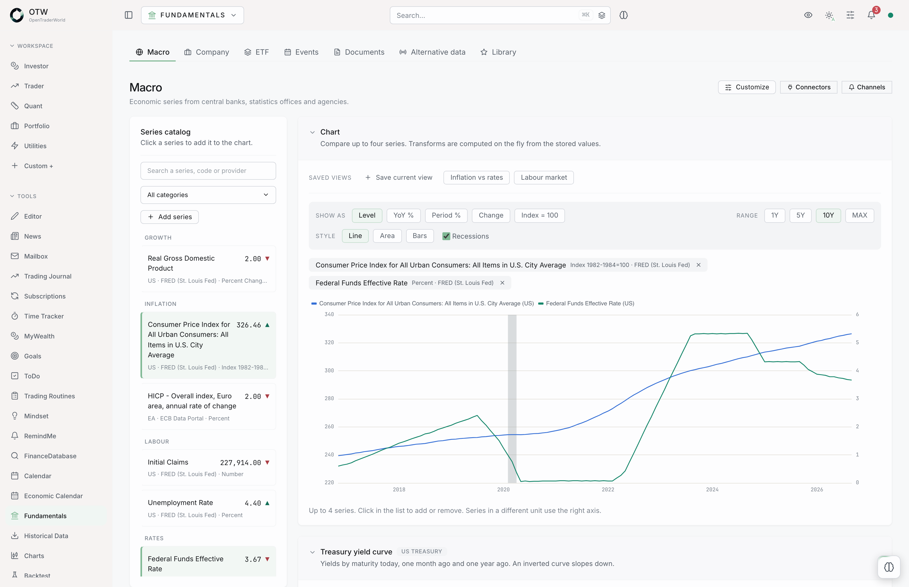
</picture>
<b>Fundamentals</b>: macro series, statements, filings, alternative data.
</td>
<td valign="top">
<picture>
  <source media="(prefers-color-scheme: dark)" srcset="docs/public/screenshots/automator-dark.gif">
  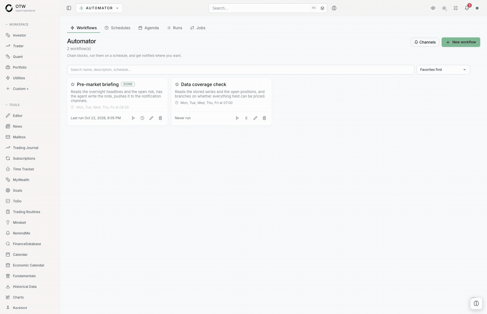
</picture>
<b>Automator</b>: scheduled workflows with AI steps and run history.
</td>
</tr>
<tr>
<td valign="top">
<picture>
  <source media="(prefers-color-scheme: dark)" srcset="docs/public/screenshots/news-dark.png">
  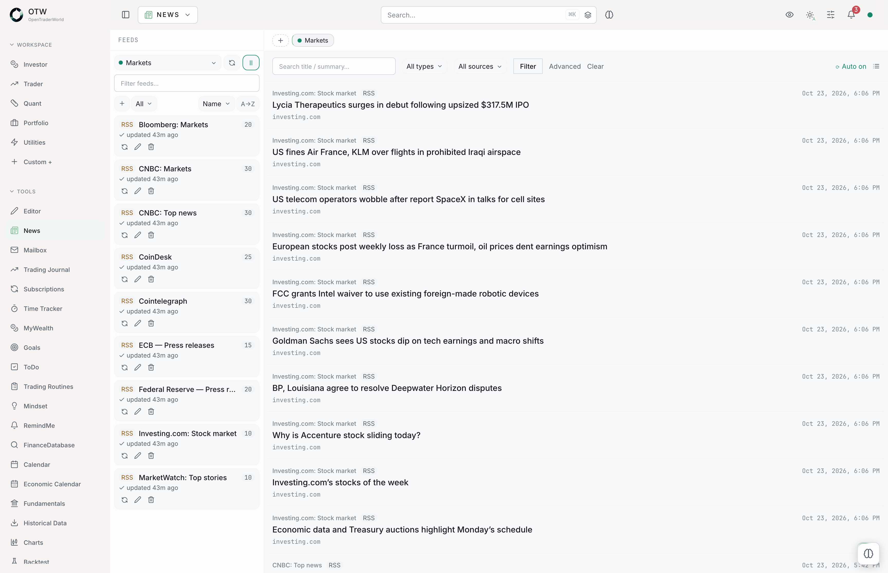
</picture>
<b>News</b>: your RSS and JSON-API feeds in one searchable stream.
</td>
<td valign="top">
<picture>
  <source media="(prefers-color-scheme: dark)" srcset="docs/public/screenshots/routines-dark.png">
  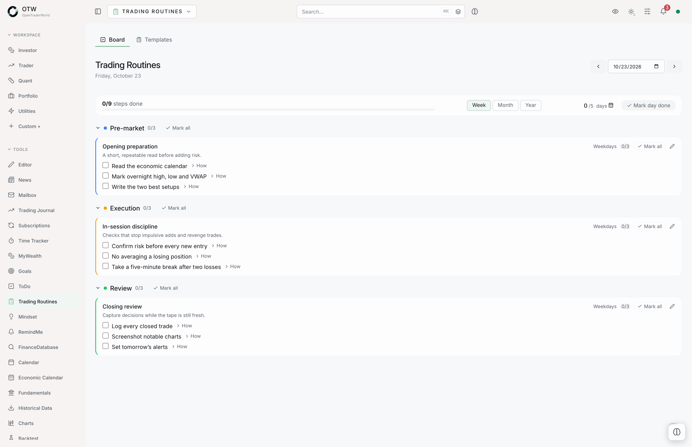
</picture>
<b>Trading Routines</b>: pre-market, in-session and review checklists.
</td>
</tr>
</table>

## Modules

Every module ships with the app. Full tour in [the module docs](https://g-otw.github.io/OpenTraderWorld/modules/).

<table>
<tr>
<td valign="top" width="33%">

**Trading**

<a href="https://g-otw.github.io/OpenTraderWorld/modules/market-data#backtest">Backtest</a><br>
<a href="https://g-otw.github.io/OpenTraderWorld/modules/market-data#histviz">Charts</a><br>
<a href="https://g-otw.github.io/OpenTraderWorld/modules/productivity#mindset">Mindset</a><br>
<a href="https://g-otw.github.io/OpenTraderWorld/config/paper-trading">Paper trading</a><br>
<a href="https://g-otw.github.io/OpenTraderWorld/modules/market-data#scanner">Scanner</a><br>
<a href="https://g-otw.github.io/OpenTraderWorld/modules/journal">Trading Journal</a><br>
<a href="https://g-otw.github.io/OpenTraderWorld/modules/robots">Trading Bots</a><br>
<a href="https://g-otw.github.io/OpenTraderWorld/modules/productivity#routines">Trading Routines</a>

</td>
<td valign="top" width="33%">

**Market data and research**

<a href="https://g-otw.github.io/OpenTraderWorld/modules/news-research#community-docs">Community Docs</a><br>
<a href="https://g-otw.github.io/OpenTraderWorld/modules/news-research#economics">Economic Calendar</a><br>
<a href="https://g-otw.github.io/OpenTraderWorld/modules/news-research#findb">FinanceDatabase</a><br>
<a href="https://g-otw.github.io/OpenTraderWorld/modules/fundamentals">Fundamentals</a><br>
<a href="https://g-otw.github.io/OpenTraderWorld/modules/market-data#histdata">Historical Data</a><br>
<a href="https://g-otw.github.io/OpenTraderWorld/modules/news-research#mailbox">Mailbox</a><br>
<a href="https://g-otw.github.io/OpenTraderWorld/modules/news-research#news">News</a><br>
<a href="https://g-otw.github.io/OpenTraderWorld/modules/market-data#options">Options</a><br>
<a href="https://g-otw.github.io/OpenTraderWorld/modules/market-data#quant">Quant Tools</a><br>
<a href="https://g-otw.github.io/OpenTraderWorld/modules/news-research#resources">Resources</a>

</td>
<td valign="top" width="33%">

**Portfolios and money**

<a href="https://g-otw.github.io/OpenTraderWorld/modules/portfolio#mportfolios">Managers' Portfolios</a><br>
<a href="https://g-otw.github.io/OpenTraderWorld/modules/portfolio#wealth">MyWealth</a><br>
<a href="https://g-otw.github.io/OpenTraderWorld/modules/portfolio#portfolios">Portfolio Tracker</a><br>
<a href="https://g-otw.github.io/OpenTraderWorld/modules/portfolio#subscriptions">Subscriptions</a><br>
<a href="https://g-otw.github.io/OpenTraderWorld/modules/portfolio#taxcalc">Tax Calculator</a><br>
<a href="https://g-otw.github.io/OpenTraderWorld/modules/portfolio#watchlists">Watchlists</a>

</td>
</tr>
<tr>
<td valign="top" width="33%">

**Productivity**

<a href="https://g-otw.github.io/OpenTraderWorld/modules/productivity#calendar">Calendar</a><br>
<a href="https://g-otw.github.io/OpenTraderWorld/modules/productivity#editor">Editor</a><br>
<a href="https://g-otw.github.io/OpenTraderWorld/modules/productivity#goals">Goals</a><br>
<a href="https://g-otw.github.io/OpenTraderWorld/modules/productivity#prompt-store">Prompt Store</a><br>
<a href="https://g-otw.github.io/OpenTraderWorld/modules/productivity#remindme">RemindMe</a><br>
<a href="https://g-otw.github.io/OpenTraderWorld/modules/productivity#time">Time Tracker</a><br>
<a href="https://g-otw.github.io/OpenTraderWorld/modules/productivity#todos">ToDo</a>

</td>
<td valign="top" width="33%">

**Automation and AI**

<a href="https://g-otw.github.io/OpenTraderWorld/modules/agent">Agent</a><br>
<a href="https://g-otw.github.io/OpenTraderWorld/modules/automator">Automator</a><br>
<a href="https://g-otw.github.io/OpenTraderWorld/config/ai-agents">MCP server</a><br>
<a href="https://g-otw.github.io/OpenTraderWorld/config/settings">Notifications</a><br>
<a href="https://g-otw.github.io/OpenTraderWorld/config/voice">Voice control</a><br>
<a href="https://g-otw.github.io/OpenTraderWorld/modules/productivity#webhooks">Webhooks</a>

</td>
</tr>
</table>

## Data and brokers

One connector list for the whole app: each provider account is set up once, with its
credentials sealed, and granted to the modules that use it. A broker account imports your fills,
positions and orders, and sends orders only where you turn **Trading** on for it.

| Provider | Markets | Data | Real time | Trading |
|---|---|:-:|:-:|:-:|
| **Alpaca** | equity, crypto, options | ✓ | ✓ | read |
| **Alpha Vantage** | equity, ETF | ✓ | | |
| **Binance** | crypto spot | ✓ | ✓ | ✓ |
| **Binance USDⓈ-M Futures** | crypto perpetuals and futures | ✓ | ✓ | ✓ |
| **Bitfinex** | crypto spot and perpetuals | ✓ | ✓ | ✓\* |
| **Bitget** | crypto spot and USDT-M futures | ✓ | ✓ | ✓\* |
| **Bybit** | crypto spot, perpetuals and futures, options (read) | ✓ | ✓ | ✓\* |
| **Bybit EU** | crypto spot | ✓ | ✓ | ✓\* |
| **Capital.com** | FX, indices, shares, crypto (CFDs) | ✓ | ✓ | read |
| **Coinbase** | crypto spot | ✓ | ✓ | ✓\* |
| **Deribit** | crypto spot, perpetuals, futures and options | ✓ | ✓ | ✓\* |
| **EODHD** | equity, ETF, FX, crypto | ✓ | | |
| **FOREX.com (StoneX)** | FX, CFDs | ✓ | | read |
| **Gate.io** | crypto spot and perpetuals | ✓ | ✓ | ✓\* |
| **Interactive Brokers** | equity, ETF, crypto, FX, index, futures, options | ✓ | ✓ | ✓ |
| **Kraken** | crypto spot | ✓ | ✓ | ✓\* |
| **Kraken Futures** | crypto perpetuals and futures | | | ✓\* |
| **KuCoin** | crypto spot | ✓ | ✓ | ✓\* |
| **KuCoin Futures** | crypto perpetuals and futures | ✓ | ✓ | ✓\* |
| **Massive (Polygon.io)** | equity, ETF, options, futures, crypto, FX, index | ✓ | ✓ | |
| **MEXC** | crypto spot and perpetuals | ✓ | ✓ | ✓\* |
| **NinjaTrader** | futures | | | read |
| **OANDA** | FX, CFDs | ✓ | | read |
| **OKX** | crypto spot, perpetuals and futures | ✓ | ✓ | ✓\* |
| **TradeStation** | equity, ETF, options, futures, index | ✓ | | read |
| **Yahoo Finance** | equity, ETF, index, crypto | ✓ | | |
| **Paper trading** (run by the app) | anything a connector serves | | | ✓ |

**Data**: history and symbol search. **Real time**: live prices with best bid and ask.
**Trading**: ✓ sends orders from the chart, **read** reads fills, positions and orders only.

\* Built from the broker's documentation, not yet tested on a real account.

> [!WARNING]
> Trading from the chart is experimental on every broker. A live account takes orders only once
> you turn **Live trading** on for it, with a size limit per order, a size limit per position
> and a loss limit. Check every order at your broker, start small, and trade at your own risk.

Real time on Interactive Brokers and Alpaca follows your market-data subscription; on Massive it
needs a paid plan. Interactive Brokers runs through your own IB Gateway or TWS. Details in the
[connectors](https://g-otw.github.io/OpenTraderWorld/config/connectors),
[broker accounts](https://g-otw.github.io/OpenTraderWorld/config/brokers) and
[trading](https://g-otw.github.io/OpenTraderWorld/config/trading) guides.
Missing a provider? [Ask for it](https://github.com/G-OTW/OpenTraderWorld/issues).

## Quick start

Requires [Docker](https://g-otw.github.io/OpenTraderWorld/guide/docker) on macOS, Linux or Windows.

```bash
curl -fsSL https://raw.githubusercontent.com/G-OTW/OpenTraderWorld/master/install.sh | bash
```

The installer generates secrets, pulls the images, starts the stack and prints your admin
password once. Then open **http://localhost:5454**.

- Step by step: [guided install](https://opentraderworld.com/hosting/setup).
- A rented Debian or Ubuntu server under your own domain: the server installer hardens the
  machine, installs over HTTPS and sets up nightly backups, in one line:
  `curl -fsSL https://get.opentraderworld.com/configure_install.sh | bash -s -- --domain app.example.com`.
  See the [installation guide](https://g-otw.github.io/OpenTraderWorld/guide/install#server-installer).
- Manual setup, headless servers, LAN, HTTPS, public exposure, backups:
  [installation guide](https://g-otw.github.io/OpenTraderWorld/guide/install).
- Page not loading over HTTP on your LAN? Your browser's HTTPS-only mode rewrites `http://`
  into `https://` and caches it. Allow HTTP for that host, or switch to LAN + HTTPS in
  Settings → Network.

**Not ready to install?** The [live demo](https://demo.opentraderworld.com) is a shared sandbox
with realistic data, reset every 15 minutes. Settings, brokers and notifications are disabled there.

## Upgrading

**Settings → Update app** tells you when a new version is out. Back up the database first;
migrations run on the first boot of the new version. Your `.env`, `network.env` and `dns.env`
are kept.

On a machine set up with the server installer, `otw update` does it all: backup, update,
and a roll back if the new version does not answer
([server install](https://g-otw.github.io/OpenTraderWorld/guide/updating#server-install)).

<details>
<summary>Default install (prebuilt images)</summary>

```bash
cd /path/to/opentraderworld
TMP=$(mktemp -d)
curl -fsSL https://codeload.github.com/G-OTW/OpenTraderWorld/tar.gz/master | tar -xz -C "$TMP"
cp -R "$TMP"/*/deploy/. deploy/
rm -rf "$TMP"
docker compose -f deploy/docker-compose.yml -f deploy/docker-compose.images.yml \
  --env-file deploy/.env --env-file deploy/network.env \
  pull
docker compose -f deploy/docker-compose.yml -f deploy/docker-compose.images.yml \
  --env-file deploy/.env --env-file deploy/network.env \
  up -d
```

</details>

<details>
<summary>Source build (full clone)</summary>

Releases are fresh snapshots: reset to the release rather than `git pull`. This discards local
edits to tracked files.

```bash
cd /path/to/OpenTraderWorld
git fetch origin
git reset --hard origin/master
docker compose -f deploy/docker-compose.yml \
  --env-file deploy/.env --env-file deploy/network.env \
  up -d --build
```

</details>

Details in [the updating guide](https://g-otw.github.io/OpenTraderWorld/guide/updating).

## Architecture

| Layer | Tech |
|---|---|
| Backend | **Rust** (Axum): API, scheduler, background jobs |
| Frontend | **SvelteKit** single-page app |
| Data | **PostgreSQL**, the only place your data lives |
| Proxy and TLS | **Caddy**, automatic HTTPS certificates |
| Deployment | **Docker Compose** |

```
OpenTraderWorld/
├── install.sh     # one-command installer
├── deploy/        # docker-compose stack, setup.sh, Caddy config
├── core/          # Rust workspace (API, store, scheduler, connectors)
├── frontend/      # SvelteKit app
├── docs/          # documentation site (VitePress)
├── fixtures/      # frozen test inputs shared by every test suite
├── scripts/       # validation and parity checks
├── testbook/      # non-regression run against a throwaway instance
└── .github/       # CI workflows (tests, docs, release images), issue templates
```

## Community

OpenTraderWorld is actively developed and grows on user feedback.

- **Star the repo** and share it: it helps other traders find the project.
- **Suggest and vote** on features at [opentraderworld.com/suggestions](https://opentraderworld.com/suggestions).
- **Report bugs** in [GitHub issues](https://github.com/G-OTW/OpenTraderWorld/issues), with the symptom and a few log lines.
- **Write a guide** in the app's Editor and submit it to the [Community Docs](https://opentraderworld.com/docs).

| Link | What you'll find |
|---|---|
| [opentraderworld.com](https://opentraderworld.com) | Project home, module overview, roadmap voting |
| [Documentation](https://g-otw.github.io/OpenTraderWorld/) | Install, configuration and module reference |
| [Live demo](https://demo.opentraderworld.com) | Shared sandbox, reset every 15 minutes |
| [Guided install](https://opentraderworld.com/hosting/setup) | Setup, step by step |

## Disclaimer

This software is for **educational and informational purposes only**. It is **not** financial,
investment, or trading advice. **USE IT AT YOUR OWN RISK.** The author and any affiliates
accept **no responsibility** for your trading or investment results, or for any loss or damage
arising from use of this software. Never risk money you cannot afford to lose. There will be
bugs: the software is provided **"as is", without warranty of any kind**. You alone are
responsible for how you use it and for the decisions you make with it.

## License

[FSL-1.1-MIT](LICENSE) (Functional Source License). Free for everyone, including commercial
use, self-hosting at work, modification, redistribution and forks. The one thing it does not
grant is a **Competing Use**: selling the software, or offering it to others as a paid product
or a hosted service. Each release turns into plain **MIT** two years after it is published.
