<div align="center">

# OpenTraderWorld

**Your trading workspace, on your own machine.**

[](https://opentraderworld.com)
[](LICENSE)
[](https://g-otw.github.io/OpenTraderWorld/)
[](https://g-otw.github.io/OpenTraderWorld/guide/install)

A free, self-hosted platform that bundles the tools traders and investors actually use: trading journal, market data and backtesting, portfolios, news, planning. Your data stays on your machine. And if you want it, your own AI agent runs the whole thing alongside you.

[**Website**](https://opentraderworld.com) ·
[Documentation](https://g-otw.github.io/OpenTraderWorld/) ·
[Install in 2 minutes](https://g-otw.github.io/OpenTraderWorld/guide/install) ·
[Module tour](https://g-otw.github.io/OpenTraderWorld/modules/) ·
[Suggest a feature](https://opentraderworld.com/suggestions) ·
[Hosting it](https://opentraderworld.com/hosting)

### [▶ Try the live demo](https://demo.opentraderworld.com)

No account, no install, already full of realistic data. It is a shared sandbox, wiped every 15 minutes.

<picture>
  <source media="(prefers-color-scheme: dark)" srcset="docs/public/screenshots/charts-dark.gif">
  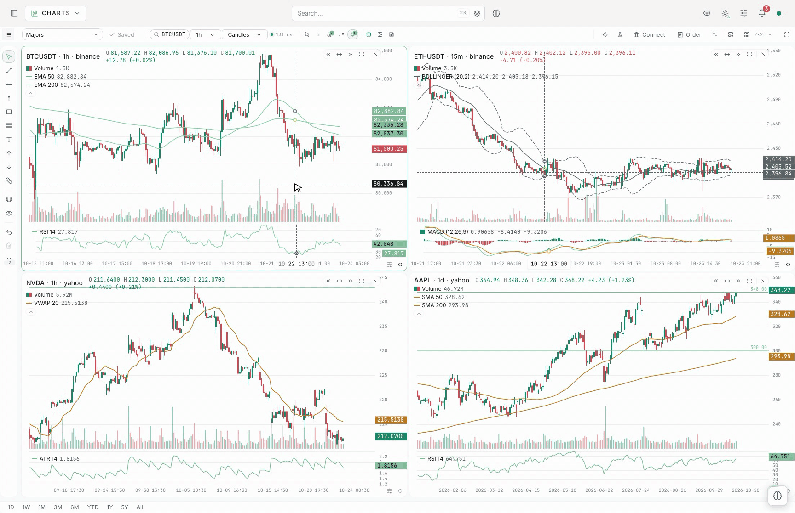
</picture>

</div>

---

## Nobody needs a new Bloomberg Terminal

Every few weeks another product promises to be "the Bloomberg Terminal for the rest of us".
It is the wrong target, because Bloomberg does not sell software.

- A Bloomberg Terminal costs roughly **$30,000 per user per year**, on two-year contracts.
  LSEG Workspace, ex-Refinitiv Eikon, sits around **$22,000** for the full tier.
- **What that money buys is immediacy and access**: news in under a second, dealer runs,
  liquidity, and a closed chat network holding the people on the other side of your trade.
- The screens, the charts, the functions are the wrapper. Nobody signs a $30k contract for
  the UI.

**OpenTraderWorld is not trying to be the next Bloomberg Terminal.** It is the workspace
around your own decisions: your journal, your portfolios, your backtests, your research, your
automations, enhanced by your favorite AI model. Free, on your machine, with the data providers you already pay for (or the free ones).

---

## Why OpenTraderWorld?

- 🆓 **Free.** No subscription, no paywall, no "pro tier". Free for everyone, whether you
  trade for a living or on the side. The idea behind it: *get profitable before spending a dime.*
- 🔒 **Private and self-hosted.** It runs on your computer or your server with Docker. No
  account, no cloud, no telemetry. Right after install it only answers on localhost, until
  *you* decide otherwise.
- 🧩 **Modular.** 25+ modules. Install what you use, detach the rest.
- 🔁 **Updated constantly.** New modules and improvements land regularly. The app tells you
  when a version is out, updating is a couple of commands it shows you, and your data always
  survives the upgrade.
- 🗳️ **Built with its users.** Feature ideas come from the people using it. Suggest yours,
  vote on other people's, watch the roadmap move. See [Contributing ideas](#-suggest-vote-contribute).
- 🌍 **7 languages.** English, French, German, Spanish, Italian, Portuguese, Chinese.
- 🤖 **AI built in, on your terms.** There is a built-in
  [assistant](https://g-otw.github.io/OpenTraderWorld/modules/agent) that chats with your own
  data. You bring the provider (Anthropic, or any OpenAI-compatible endpoint), and it gets
  memory, skills and tool access scoped by token. There is also a built-in
  [MCP server](https://g-otw.github.io/OpenTraderWorld/config/ai-agents), so *external* agents
  can read or update your modules through that same token-scoped gateway. Both are off until
  you turn them on. Your keys are encrypted at rest and never reach the browser.
- ⚙️ **Automate as much or as little as you like.** The
  [automator](https://g-otw.github.io/OpenTraderWorld/modules/automator) turns your routines
  into scheduled workflows: imports, reports, market scans, alerts, daily reviews. Any of them
  can hand a step to your own AI model, or be driven by it from end to end. You stay in charge
  the whole way: nothing runs, sends or writes anything you did not switch on yourself.
- 🔑 **Secrets stay sealed.** An encrypted [Vault](https://g-otw.github.io/OpenTraderWorld/config/settings#vault)
  holds the credentials the app needs on your behalf. Encrypted at rest, write-only once saved,
  and plugged into any module by reference so you never paste them twice.

## Quick start

You need [Docker](https://g-otw.github.io/OpenTraderWorld/guide/docker) (macOS, Linux or Windows).

```bash
curl -fsSL https://raw.githubusercontent.com/G-OTW/OpenTraderWorld/master/install.sh | bash
```

The installer asks a few questions, generates strong secrets, pulls the prebuilt images and
starts the stack, creates your admin account and prints its password once. Then open
**http://localhost:5454** and sign in. If you want the long version (manual setup, headless
servers, LAN/HTTPS/public exposure, backups), it is all in
[the documentation](https://g-otw.github.io/OpenTraderWorld/guide/install).

> [!TIP]
> **Prefer to be walked through it?** The guided install on the website takes you through it
> step by step.
>
> [](https://opentraderworld.com/hosting/setup)

> **If the page won't load over plain HTTP.** Browsers with HTTPS-only mode (Chrome/Edge
> HTTPS-First, Firefox HTTPS-Only, Safari) rewrite `http://` into `https://` and then cache
> that redirect, so a LAN install answers nothing at all. Open the address in a private
> window to confirm that is what is happening, then allow HTTP for that host. Or switch to
> the LAN + HTTPS mode in Settings → Network and get a real certificate.

## A look inside

Every image below is the real app, captured from a local install. Prices, news and backtests are
real; the journal, portfolio and fundamentals figures are sample data. The images follow your
GitHub theme, light or dark.

### Dashboard

Workspaces for each hat you wear (investor, trader, quant, portfolio), built from widgets: net
worth, positions, live quotes, headlines, upcoming macro releases, goals. Rearrange them or add
your own.

<picture>
  <source media="(prefers-color-scheme: dark)" srcset="docs/public/screenshots/dashboard-dark.gif">
  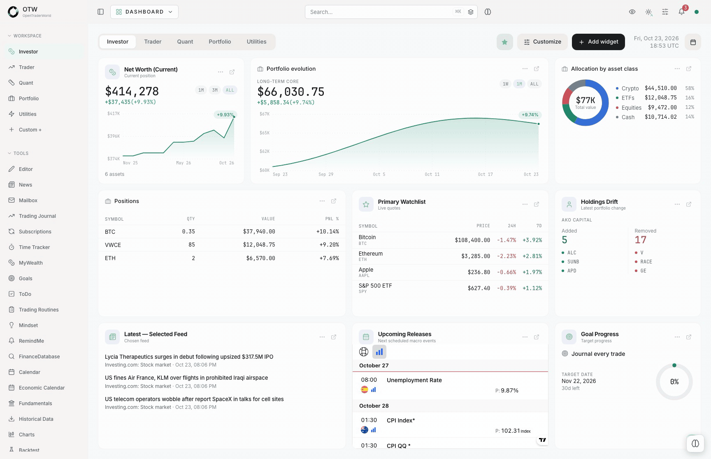
</picture>

### Charts

Up to twelve linked charts per workspace, drawing tools, built-in studies and alerts. Paste a Pine
Script v5/v6 indicator once, keep it in your library, and add it to any chart.

**Trade from the chart** (experimental): send, move and cancel orders and close positions on
Interactive Brokers, Binance, Binance USDⓈ-M Futures and the app's own paper trading account,
with your own risk limits and a kill switch. A live account takes orders only once you turn
live trading on for it, with its limits set. See [Trading from the chart](https://g-otw.github.io/OpenTraderWorld/config/trading).

> [!WARNING]
> Chart trading is new. It is heavily tested, against simulated venues and the brokers' own
> test environments, but bugs can remain. Check every order at your broker, start small, and
> trade at your own risk.

<picture>
  <source media="(prefers-color-scheme: dark)" srcset="docs/public/screenshots/charts-pine-dark.png">
  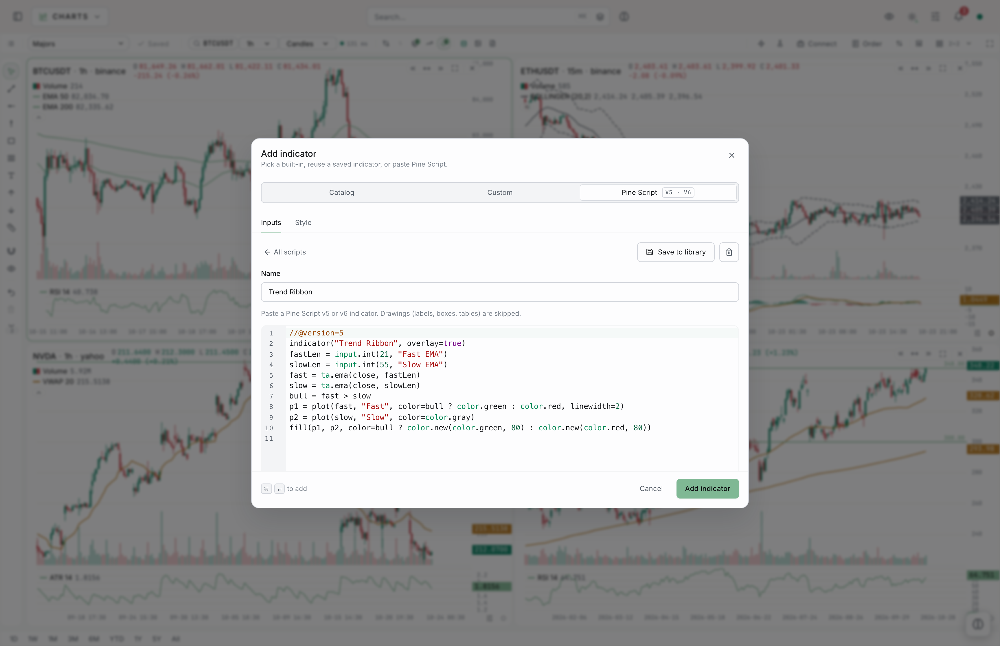
</picture>

### Backtest

Load a saved strategy, pick a dataset, run. The report puts every trade on the chart, with the
figures that matter next to buy and hold. Shown here: an EMA 21/55 crossover on ten years of
AAPL daily bars, +375% against +1,217% for buy and hold. The engine does not flatter a strategy.

<picture>
  <source media="(prefers-color-scheme: dark)" srcset="docs/public/screenshots/backtest-dark.gif">
  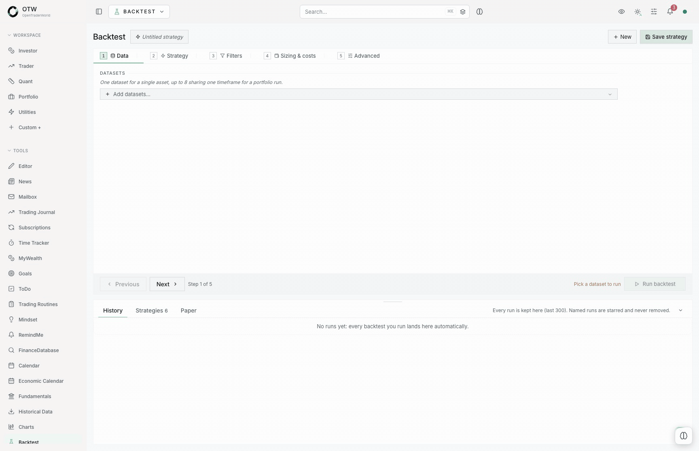
</picture>

### Trading Journal

Your trades with their equity curve, win rate, profit factor, Sharpe and drawdown, filtered by
side, ticker, strategy, class or tag. R-multiple analytics, behaviour patterns and a PnL calendar
sit one click away.

<picture>
  <source media="(prefers-color-scheme: dark)" srcset="docs/public/screenshots/journal-dark.png">
  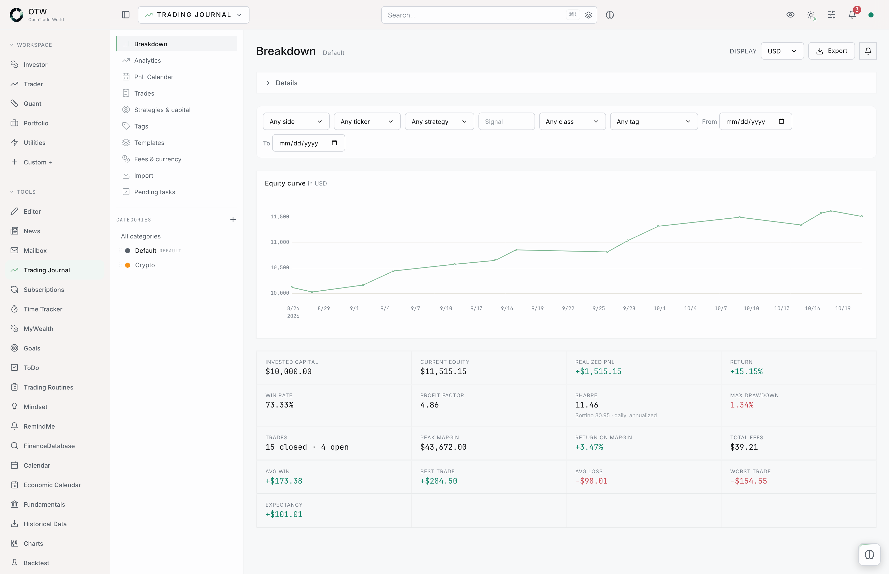
</picture>

### Portfolio Tracker

Holdings priced daily, cost basis, unrealized and realized P/L, allocation by asset or class, and
the full ledger of operations behind them.

<picture>
  <source media="(prefers-color-scheme: dark)" srcset="docs/public/screenshots/portfolio-dark.png">
  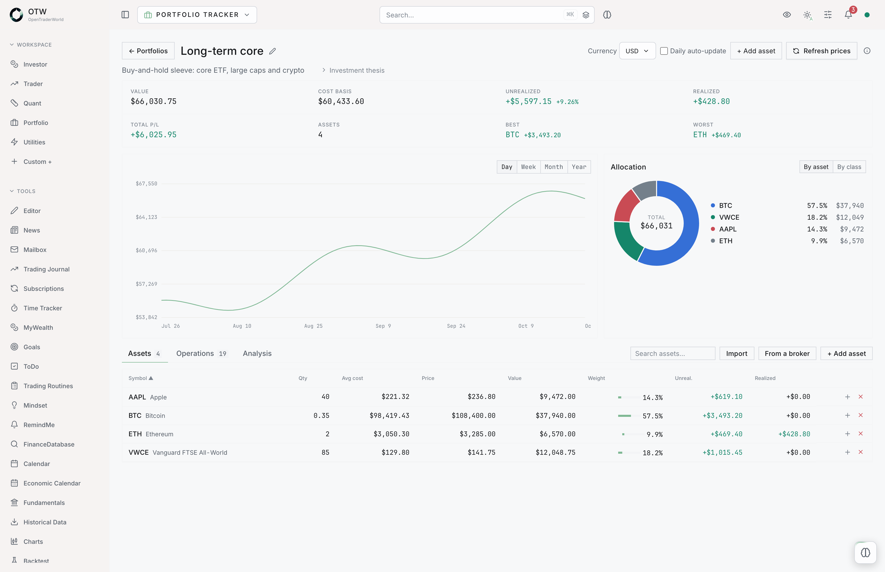
</picture>

### Quant Tools

The risk profile of any stored dataset: volatility, drawdown, value at risk, expected shortfall
and the return distribution. Then correlation, efficient frontier, position sizing and
derivatives in the next tabs.

<picture>
  <source media="(prefers-color-scheme: dark)" srcset="docs/public/screenshots/quant-dark.png">
  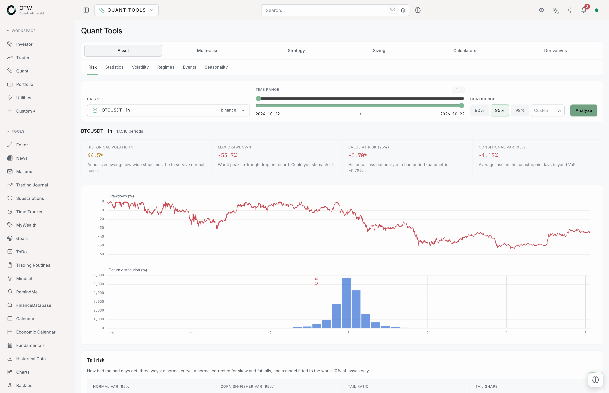
</picture>

### Fundamentals

Macro series from central banks and statistics offices, charted together with recession
shading. Company statements, filings, ETFs, a market calendar and alternative data live in the
next tabs.

<picture>
  <source media="(prefers-color-scheme: dark)" srcset="docs/public/screenshots/fundamentals-dark.png">
  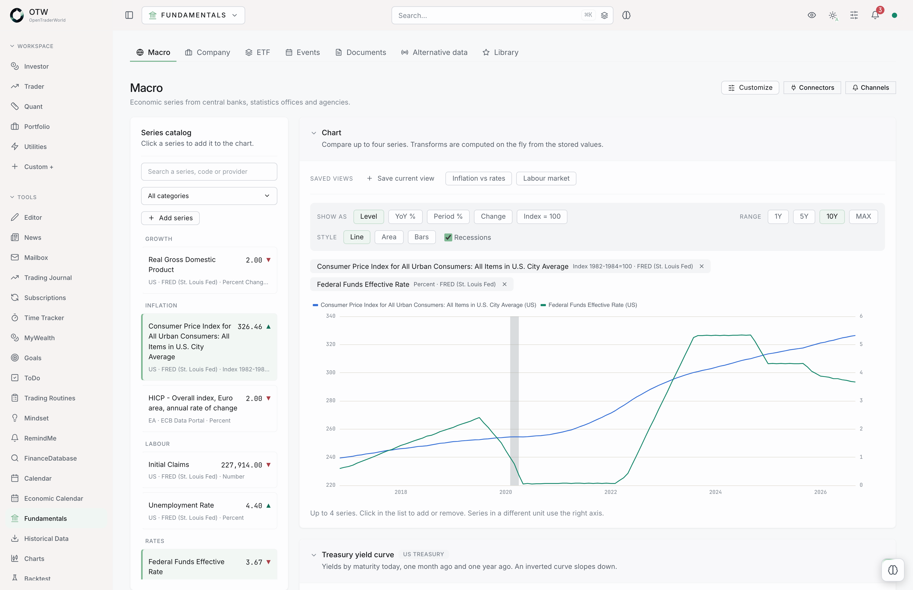
</picture>

### News

Your RSS and JSON-API feeds in one stream, polled on a schedule, searchable and filterable by
source.

<picture>
  <source media="(prefers-color-scheme: dark)" srcset="docs/public/screenshots/news-dark.png">
  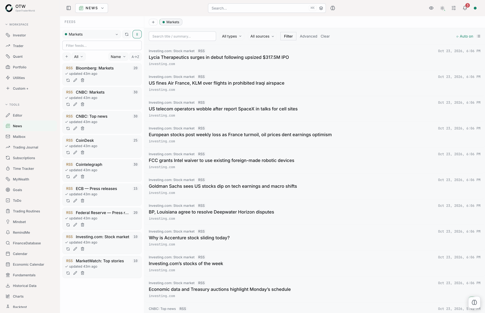
</picture>

### Automator

Chain blocks into a workflow: a call to the app's own API or any URL, an AI step, a condition, a
notification. Put it on a schedule and read every run afterwards.

<picture>
  <source media="(prefers-color-scheme: dark)" srcset="docs/public/screenshots/automator-dark.gif">
  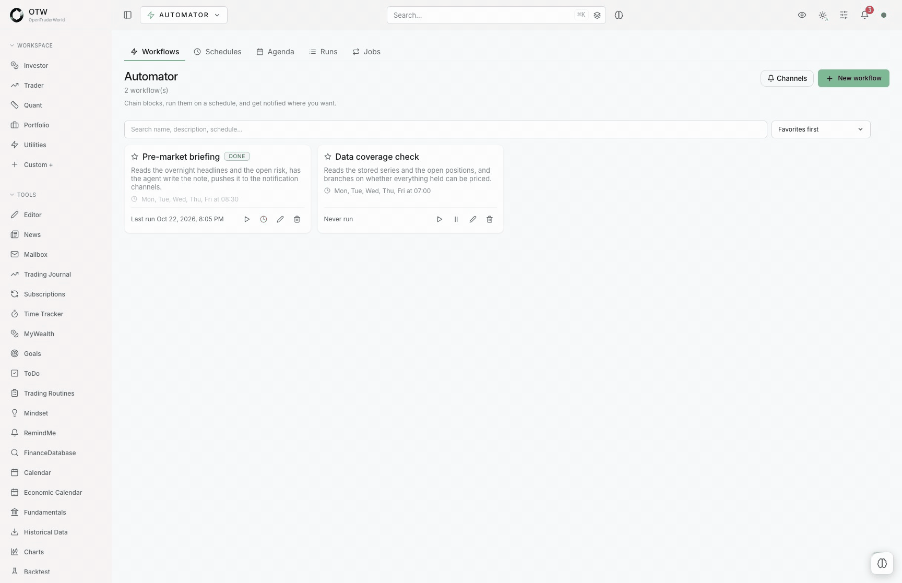
</picture>

### Trading Routines

Pre-market, in-session and review checklists, each step with its own how-to, tracked by week,
month and year.

<picture>
  <source media="(prefers-color-scheme: dark)" srcset="docs/public/screenshots/routines-dark.png">
  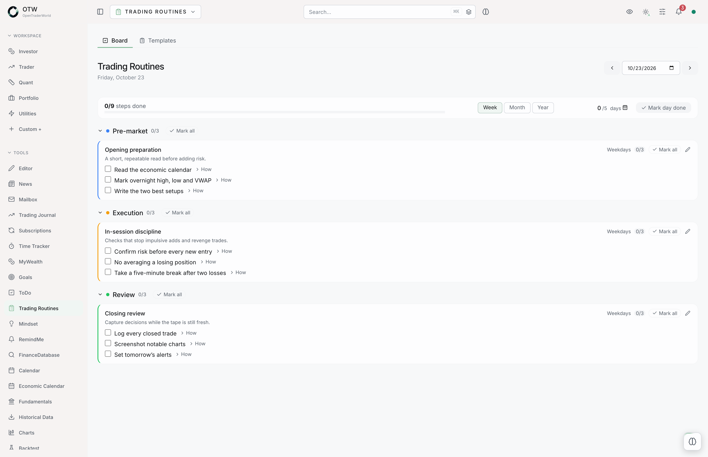
</picture>

## Upgrading

**Settings → Update app** tells you when a new version is out. The app cannot update itself
(it has no shell or Docker access, by design), so run these on the host. Take a database
backup first; migrations run automatically on the new container's first boot.

A default install (prebuilt images, no git checkout) refreshes `deploy/` from the latest
release (the public `master`), then pulls the new images. Your `.env`, `network.env` and `dns.env` are left alone.

```bash
cd /path/to/opentraderworld
TMP=$(mktemp -d)
curl -fsSL https://codeload.github.com/G-OTW/OpenTraderWorld/tar.gz/master | tar -xz -C "$TMP"
cp -R "$TMP"/*/deploy/. deploy/
rm -rf "$TMP"
docker compose -f deploy/docker-compose.yml -f deploy/docker-compose.images.yml \
  --env-file deploy/.env --env-file deploy/network.env \
  pull
docker compose -f deploy/docker-compose.yml -f deploy/docker-compose.images.yml \
  --env-file deploy/.env --env-file deploy/network.env \
  up -d
```

A source build (installed with `--build`, from a full clone) refreshes the checkout and
rebuilds. Releases are fresh snapshots, so reset to the release rather than `git pull`.
`git reset --hard` discards any local edits to tracked files.

```bash
cd /path/to/OpenTraderWorld
git fetch origin
git reset --hard origin/master
docker compose -f deploy/docker-compose.yml \
  --env-file deploy/.env --env-file deploy/network.env \
  up -d --build
```

## Try it without installing

There is a public sandbox at **[demo.opentraderworld.com](https://demo.opentraderworld.com)**,
also linked from the [website](https://opentraderworld.com). No account, no install, and it
comes seeded with realistic data so you land in an instance that looks used rather than empty.

One thing to keep in mind: it is *shared*. Everything you type is visible to other visitors,
the whole database is wiped and re-seeded **every 15 minutes**, connectors are read-only, and
settings, the Vault, broker accounts, notification channels and paper trading are disabled. It runs on a small free-tier server with free AI models, so it is
slower than a local install. For anything real, install it. Two minutes.

## What's inside

Every module ships with the app. Install what you use, detach the rest.

### Trading

| Module | What it does |
|---|---|
| [Trading Journal](https://g-otw.github.io/OpenTraderWorld/modules/journal) | Trade log with templates, fee schedules, multi-currency FX and performance stats. |
| [Trading Routines](https://g-otw.github.io/OpenTraderWorld/modules/productivity#routines) | Recurring session checklists: pre-market prep, in-session discipline, post-market review. |
| [Mindset](https://g-otw.github.io/OpenTraderWorld/modules/productivity#mindset) | Daily mood and discipline check-ins, with trends over time. |

### Market data and analysis

| Module | What it does |
|---|---|
| [Historical Data](https://g-otw.github.io/OpenTraderWorld/modules/market-data#histdata) | Download OHLCV history from several providers into local datasets, or import your own file. |
| [Charts](https://g-otw.github.io/OpenTraderWorld/modules/market-data#histviz) | 18 chart types (candles, Heikin Ashi, Renko, Kagi, point & figure…) with indicators, Pine Script v5/v6 compatible scripts and alerts, live or on demand, on any instrument a connector serves. |
| [Backtest](https://g-otw.github.io/OpenTraderWorld/modules/market-data#backtest) | Signal, grid and DCA strategies with sizing, costs, an optimizer and paper trading forward. |
| [Quant Tools](https://g-otw.github.io/OpenTraderWorld/modules/market-data#quant) | Risk and return analytics: VaR, correlation, efficient frontier, position sizing, Kelly. |
| [Scanner](https://g-otw.github.io/OpenTraderWorld/modules/market-data#scanner) | Watches instruments and hives of them with reusable signals, events and candlestick patterns on each closed bar, shows them on boards and notifies the hits. |
| [Fundamentals](https://g-otw.github.io/OpenTraderWorld/modules/fundamentals) | Macro series, company statements, SEC filings, transcripts, ETFs, a market calendar and alternative data from primary sources and the aggregators you connect. |

### Portfolios and money

| Module | What it does |
|---|---|
| [Watchlists](https://g-otw.github.io/OpenTraderWorld/modules/portfolio#watchlists) | Symbol watchlists with live prices, day changes, sparklines and notes. |
| [Portfolio Tracker](https://g-otw.github.io/OpenTraderWorld/modules/portfolio#portfolios) | Live portfolio value with a buy/sell ledger and holdings priced daily. |
| [MyWealth](https://g-otw.github.io/OpenTraderWorld/modules/portfolio#wealth) | Net worth across everything you own: accounts, property, crypto, valuables. |
| [Managers' Portfolios](https://g-otw.github.io/OpenTraderWorld/modules/portfolio#mportfolios) | Superinvestor 13F holdings, browsable and snapshotable. |
| [Tax Calculator](https://g-otw.github.io/OpenTraderWorld/modules/portfolio#taxcalc) | Trading and investing tax estimates from country templates. |
| [Subscriptions](https://g-otw.github.io/OpenTraderWorld/modules/portfolio#subscriptions) | Your recurring subscriptions and what they cost you. |

### News and research

| Module | What it does |
|---|---|
| [News](https://g-otw.github.io/OpenTraderWorld/modules/news-research#news) | RSS and JSON-API news aggregator with polling dashboards. |
| [Mailbox](https://g-otw.github.io/OpenTraderWorld/modules/news-research#mailbox) | Newsletters, market news and broker mail read from your own IMAP mailbox, tracker-free. |
| [Economic Calendar](https://g-otw.github.io/OpenTraderWorld/modules/news-research#economics) | Upcoming macro events. |
| [FinanceDatabase](https://g-otw.github.io/OpenTraderWorld/modules/news-research#findb) | Search 300,000+ instruments locally, and file your favorites in folders. |
| [Resources](https://g-otw.github.io/OpenTraderWorld/modules/news-research#resources) | Bookmark library for books, links and references. |
| [Community Docs](https://g-otw.github.io/OpenTraderWorld/modules/news-research#community-docs) | Guides written by the community, synced and readable offline. |

### Notes and organization

| Module | What it does |
|---|---|
| [Editor](https://g-otw.github.io/OpenTraderWorld/modules/productivity#editor) | Rich document editor with folders and table/kanban/gallery databases. |
| [ToDo](https://g-otw.github.io/OpenTraderWorld/modules/productivity#todos) | Task list with due dates and categories. |
| [Goals](https://g-otw.github.io/OpenTraderWorld/modules/productivity#goals) | Goals with metric tracking and deadlines. |
| [Calendar](https://g-otw.github.io/OpenTraderWorld/modules/productivity#calendar) | Personal event calendar, with reminders, todos and goals overlaid on it. |
| [RemindMe](https://g-otw.github.io/OpenTraderWorld/modules/productivity#remindme) | Reminders with in-app notifications and email/Telegram/Slack/Discord channels. |
| [Time Tracker](https://g-otw.github.io/OpenTraderWorld/modules/productivity#time) | Project timers with budgets and hourly-rate value. |
| [Prompt Store](https://g-otw.github.io/OpenTraderWorld/modules/productivity#prompt-store) | Searchable library of reusable AI prompts, tagged, rated and versioned. |
| [Webhooks](https://g-otw.github.io/OpenTraderWorld/modules/productivity#webhooks) | Private inbound URLs that turn external alerts into notifications or Automator runs. |
| [Automator](https://g-otw.github.io/OpenTraderWorld/modules/automator) | Scheduled workflows: call your own API or any URL, ask an AI step, transform, notify. |

### AI

| Module | What it does |
|---|---|
| [Agent](https://g-otw.github.io/OpenTraderWorld/modules/agent) | Built-in AI chat assistant. Bring your own provider, switch model or prompt mid-conversation, and let it act on your data through MCP, with memory, skills and external MCP servers. Reachable from a floating chat on every page. |

The full tour, with details, is in [the module docs](https://g-otw.github.io/OpenTraderWorld/modules/).

## Backtesting: signals, grid, DCA

One engine, three ways to describe a strategy. No code.

- **[Signals](https://g-otw.github.io/OpenTraderWorld/modules/market-data#backtest).** Entry and
  exit rules from indicators, price and values, long or short, with stops, pyramiding, and
  sizing by fixed quantity, percent of equity, risk per trade, Kelly or equity tiers. Build your own indicators,
  and the chart draws the same ones.
- **[Grid](https://g-otw.github.io/OpenTraderWorld/modules/market-data#grid-strategy).** A ladder
  of levels between two bounds, long, short or neutral. Each cell buys low and sells one level up.
- **[DCA](https://g-otw.github.io/OpenTraderWorld/modules/market-data#dca-savings-plan).** A
  weighted basket bought over time, never rebalanced: recurring contributions, buy tranches on a
  dip, sell rules on a gain objective. Measured like a savings plan, with IRR and a
  deposit-adjusted drawdown.

Run any of them on one instrument or a whole portfolio, with exposure limits and a per-asset
breakdown.

### Optimizer

Take a run and vary its parameters: indicator lengths, thresholds, stops, sizing, costs,
portfolio limits, grid settings, DCA amounts, excluded weekdays. Each gets a from / to / step.

- It **prices the job first**, from what past runs measured on your own machine. Stop at any
  point and keep what is computed.
- **Rank** on Sharpe, Sortino, return, net PnL, profit factor, win rate, expectancy, average
  trade, drawdown or trades. Any column re-sorts after, except the out-of-sample return: it is
  shown, never ranked.
- **The spread matters more than the winner**: worst, average, best, and how many variants came
  out positive. One good number surrounded by terrible neighbours is noise.
- **A multiple-testing haircut** puts the best Sharpe against the bar the best of *N* worthless
  strategies would clear anyway. Below it, the winner is explained by the number of tries.
- Click any variant to read its full backtest. Nothing is stored until you keep it.

Add an **in-sample / out-of-sample split** and the two stat blocks sit side by side. A wide gap
between them is overfitting.

## Paper trading: the backtest, left running forward

Press one button on a run you like and it keeps going on new candles. There is no second
engine and no serialized simulator to drift: each tick reloads the window, runs the ordinary
backtest, and diffs the trades against what is already stored. A session opened from a result
reproduces that result exactly.

- **Its own schedule**: every N minutes, daily, weekly, monthly or once, in your timezone.
- **Live alerts** on entries and exits, or **a period summary** instead. Alert on every tick,
  only when something changed, or never.
- **Summary cadence**: on each tick, hourly, daily or weekly. Entry and exit alerts always
  leave on the tick that produced them; turn them off to get only the summary.
- **Your wording, not ours.** Entry, exit and summary messages are templates you write, with a
  preview against a sample trade before you save.
- Anything the app could not deliver waits in the session inbox. You read it at the next login.

Filter alerts down to the tickers you care about, and pick which channels a session pushes to.

## Data connectors

One connector list for the whole app. A connector is a provider account, its credentials
(typed in or plugged from the encrypted Vault, write-only once saved), an optional request
limit, and the modules allowed to use it. Modules have no provider settings of their own.

| Provider | Credentials | Asset types | Symbol search | Live stream |
|---|---|---|---|---|
| **Binance** | none | crypto spot | yes | yes |
| **Binance USDⓈ-M Futures** | none | crypto perpetuals and futures | yes | yes |
| **Bitfinex** | none | crypto spot and perpetuals | yes | yes |
| **Bitget** | none | crypto spot and USDT-M futures | yes | yes |
| **Bybit** | none | crypto spot, perpetuals and futures | yes | yes |
| **Bybit EU** | none | crypto spot | yes | yes |
| **Coinbase** | none | crypto spot | yes | yes |
| **Deribit** | none | crypto spot, perpetuals, futures and options | yes | yes |
| **Gate.io** | none | crypto spot and perpetuals | yes | yes |
| **Kraken** | none | crypto spot | yes | yes |
| **KuCoin** | none | crypto spot | yes | yes |
| **KuCoin Futures** | none | crypto perpetuals and futures | yes | yes |
| **MEXC** | none | crypto spot and perpetuals | yes | yes |
| **OKX** | none | crypto spot, perpetuals and futures | yes | yes |
| **Yahoo Finance** | none | equity, ETF, index, crypto | yes | no |
| **Alpha Vantage** | API key | equity, ETF | yes | no |
| **EODHD** | API key | equity, ETF, FX, crypto | yes | no |
| **Alpaca** | key + secret | equity, crypto, options | yes | yes (based on your broker subscription) |
| **Massive (Polygon.io)** | API key | equity, ETF, options, futures, crypto, FX, index | yes | yes (paid plan) |
| **OANDA** | API token + account id | FX, CFDs | yes | no |
| **TradeStation** | OAuth: client id, secret, refresh token | equity, ETF, options, futures, index | by symbol | no |
| **FOREX.com (StoneX)** | username + password + AppKey | FX, CFDs | yes | no |
| **Capital.com** | API key + identifier + password | FX, indices, shares, crypto (all CFDs) | yes | yes |
| **Interactive Brokers** | none (your own gateway) | equity, ETF, crypto, FX, index, futures, options | yes | yes (based on your broker subscription) |

Every provider connects directly, with an API key or none at all. Interactive Brokers is the
exception: you run IB Gateway or TWS yourself and the connector stores a host and a port.
OANDA, TradeStation, FOREX.com and Capital.com are broker feeds: they read the prices of the
account you already have there, so they ask for that account's credentials.
Details in [the connectors guide](https://g-otw.github.io/OpenTraderWorld/config/connectors).

### Live feeds

Every timeframe a provider downloads, it also streams, daily and weekly included. A provider
that publishes one grain (Alpaca, Massive, Interactive Brokers) has the larger timeframes folded
from it, and a session-shaped candle (daily, weekly) is re-read from the provider once it closes.

| Provider | Price updates from | Best bid / ask |
|---|---|---|
| **Binance**, **Binance USDⓈ-M Futures** | candles | yes |
| **Bitfinex**, **Bitget**, **Bybit**, **Bybit EU**, **Deribit** | candles | yes |
| **Gate.io**, **Kraken**, **KuCoin**, **KuCoin Futures**, **MEXC**, **OKX** | candles | yes |
| **Coinbase** | trades | yes |
| **Capital.com** | bid and ask candles, charted at their mid | yes, from the candles |
| **Alpaca** | one-minute bars (trades on options) | yes |
| **Massive** | one-minute aggregates | yes, a separate Massive plan; none on indices |
| **Interactive Brokers** | trades (midpoint on cash FX and crypto, five-second bars on options and indices) | yes, none on indices |

OANDA, TradeStation and FOREX.com download history but do not stream: their live prices are not
served over a WebSocket. A chart can draw the live best bid and ask as two lines, and paper
trading fills on them.

Missing a provider? [Ask for it](https://github.com/G-OTW/OpenTraderWorld/issues) and it gets
added.

## Broker accounts

A broker account links to the place you trade, and only reads by default. It imports your fills into
the journal, aligns a portfolio on what the account holds, draws positions and working orders
on the chart, and reads a tax year. It sends orders only where the broker takes them and you
turn **Trading** on for the account ([experimental](https://g-otw.github.io/OpenTraderWorld/config/trading)).

| Broker | Reads | Trading from the chart |
|---|---|---|
| **Interactive Brokers (Gateway)** | recent fills (chart markers), positions, orders, account | yes, experimental (live and paper accounts) |
| **Binance** | fills, orders, holdings, account | yes, experimental (live and Spot Demo Mode) |
| **Binance USDⓈ-M Futures** | fills, positions, orders, margin balances | yes, experimental (live and futures testnet) |
| **Paper trading** (simulated, run by the app) | fills, positions, orders, account | yes |
| **Alpaca** | fills, positions, orders, holdings | no |
| **Bitfinex**, **Bitget**, **Bybit**, **Deribit**, **Gate.io**, **MEXC**, **OKX** | fills, positions, orders, holdings | no |
| **Bybit EU**, **Coinbase Advanced Trade**, **Kraken**, **KuCoin** | fills, orders, holdings | no |
| **KuCoin Futures** | fills, positions, orders | no |
| **OANDA**, **TradeStation**, **FOREX.com (StoneX)**, **Capital.com**, **NinjaTrader** | fills, positions, orders, holdings | no |
| **Interactive Brokers (Flex)** | fills, positions, holdings | no |

Where a broker issues a view-only key, the form asks for that one. Journal imports from
Interactive Brokers go through the Flex account. A live account trades only once you turn
**Live trading** on for it, which requires a size limit per order, a size limit per position and
a loss limit. Details in
[the broker accounts guide](https://g-otw.github.io/OpenTraderWorld/config/brokers).

## Fundamentals

Macro series, company statements, SEC filings, earnings-call transcripts, ETF holdings, a
market calendar and alternative data, read from the sources that publish them and stored in
your own database. Every source is a data connector granted to the module; nothing is fetched
until you add one. When several providers serve the same data, they are tried in the order you
set.

| Provider | Key | What it serves |
|---|---|---|
| **SEC EDGAR** | none | statements, filings, insider trades |
| **FRED (St. Louis Fed)** | free | macro series |
| **US Treasury** | none | yield curve, public debt |
| **ECB, Eurostat** | none | euro-area macro series |
| **BIS** | none | central-bank policy rates, effective exchange rates |
| **OECD, IMF, World Bank** | none | leading indicators, World Economic Outlook, country data |
| **BLS, BEA, EIA, US Census** | free | US macro detail |
| **CFTC** | none | Commitments of Traders |
| **FINRA** | none | short interest |
| **Financial Modeling Prep** | free tier (holders and transcripts: Ultimate plan) | estimates, earnings, segments, dividends, holders, peers, ESG, ETF, calendar, transcripts |
| **Finnhub** | free tier (estimates, ESG, transcripts, congress trades: premium) | estimates, earnings, peers, ESG, calendar, transcripts, congress trades |
| **Alpha Vantage** | free tier | estimates, earnings, dividends, ETF, calendar, transcripts |
| **EODHD** | paid | dividends, ETF, calendar |
| **Massive (Polygon.io)** | free tier | dividends, short interest |
| **USAspending** | none | government contracts |
| **LDA.gov** | free | lobbying |
| **USPTO Open Data Portal** | free | patents |
| **Quiver Quant** | paid | congress trades, lobbying, contracts, patents |

Prices and market ratios come from any market-data connector with daily equity bars. Details
in [the Fundamentals guide](https://g-otw.github.io/OpenTraderWorld/modules/fundamentals).

## Notifications

These are the notification methods available today. More are planned: if your preferred one is
missing, [ask for it](https://github.com/G-OTW/OpenTraderWorld/issues).

| Channel | What you provide |
|---|---|
| **Email** | your own SMTP server |
| **Telegram** | a bot token and a chat id |
| **Slack** | an incoming webhook URL |
| **Discord** | an incoming webhook URL |

Secrets are sealed on save and never shown again. What can notify you: chart alerts and broker
reconcile notices, paper trading sessions, watchlist alerts, reminders, finished or parked data
downloads, fundamentals refreshes, new mail, journal, portfolio and tax imports, live feed
outages, sign-in alerts, inbound webhooks, and any automator workflow. Everything is off until you switch it on, and
in-app notifications work without configuring a single channel.

## Voice control

Push to talk, never always listening: the microphone opens while you hold a shortcut (or click
the mic in the top bar) and closes when you release.

- **Command mode** (`Alt+V`): what you say becomes a plan. *"open journal"* works out of the
  box in seven languages; anything no command matches can go to the AI agent.
- **Dictation mode** (`Alt+Shift+V`): what you say is typed into the focused text field, never
  read as a command.
- **Voice commands**: a phrase you choose runs a sequence of steps (open a page, ask the agent,
  run an Automator workflow, switch theme, hide figures, speak a sentence). Say several in one
  go, *"turtle, then open settings"*, and they run in order.
- **Confirmation first**: every plan is shown before it runs, unless you mark a command to skip
  it (off by default). A phrase fires only on its own, never as a word inside a sentence.

Speech engines work like the other brokers: one list in Settings → Voice, keys sealed or
plugged from the Vault.

| Engine | Setup | Where the audio goes |
|---|---|---|
| **This browser** | none (Chrome, Edge, Safari) | the browser vendor's speech service |
| **Self-hosted Whisper** | optional bundled service, `--profile voice` | stays on your machine |
| **whisper.cpp** | your own server | stays on your server |
| **OpenAI, Groq** | API key | that provider |
| **Any OpenAI-compatible server** | URL, model, optional key | that server |

The browser only allows the microphone over HTTPS or on localhost. Details in
[the voice control guide](https://g-otw.github.io/OpenTraderWorld/config/voice).

## ⭐ Enjoying it? Help it grow

OpenTraderWorld is free and built in the open. If it is useful to you, the easiest way to give
back costs nothing:

- **Star the repo.** It is a quick signal, and it helps other people find the project.
- **Share it.** A word to a fellow trader, a link in your community, a mention anywhere. It
  helps more than you would think.

No pressure. Even just trying it out and telling a friend means a lot. 🙏
Got ideas, or found a bug? See [Suggest, vote, contribute](#-suggest-vote-contribute) below.

## 💡 Suggest, vote, contribute

This project grows on user feedback:

- **Suggest a feature or a module.** Head to
  [opentraderworld.com/suggestions](https://opentraderworld.com/suggestions) and describe what
  you are missing and how you would use it.
- **Vote.** 👍 the suggestions you want most on the website. Popular requests get prioritized.
- **Report bugs.** Open an [issue](https://github.com/G-OTW/OpenTraderWorld/issues) with the
  symptom and a few log lines.
- **Write for the community.** Guides written in the app's Editor can be submitted for
  publication in the shared [Community Docs](https://opentraderworld.com/docs) library, where
  every install can read them.

## Project links

| Where | What you'll find |
|---|---|
| [**opentraderworld.com**](https://opentraderworld.com) | Project home: module overview, community guides, roadmap voting, demo. |
| [opentraderworld.com/tools](https://opentraderworld.com/tools) | The 25+ modules by domain, in plain language. |
| [opentraderworld.com/docs](https://opentraderworld.com/docs) | Community Docs: trading guides written by users, synced into every install. |
| [opentraderworld.com/hosting/setup](https://opentraderworld.com/hosting/setup) | Guided install, step by step. |
| [opentraderworld.com/suggestions](https://opentraderworld.com/suggestions) | Suggestions and polls: propose features, vote on the roadmap. |
| [demo.opentraderworld.com](https://demo.opentraderworld.com) | Live shared demo, reseeded every 15 minutes. |
| [Documentation](https://g-otw.github.io/OpenTraderWorld/) | Install, configuration and module reference. |
| [GitHub](https://github.com/G-OTW/OpenTraderWorld) | Source, releases, issues. |

## Under the hood

| Layer | Tech |
|-------|------|
| Backend / core | **Rust** (Axum): API, scheduler, background jobs |
| Frontend | **SvelteKit** single-page app |
| Data | **PostgreSQL**, the only place your data lives |
| Reverse proxy / TLS | **Caddy**, automatic HTTPS certificates |
| Deployment | **Docker Compose**, non-intrusive and quickly rebuilt |

```
OpenTraderWorld/
├── install.sh     # one-command installer (fetches deploy/, runs setup)
├── deploy/        # docker-compose stack, setup.sh, Caddy config
├── core/          # Rust workspace (API, store, scheduler, feeds…)
├── frontend/      # SvelteKit app (modules UI)
├── docs/          # documentation site (VitePress)
├── scripts/       # validation and parity checks
└── testbook/      # non-regression run against a throwaway instance
```

## Status

Actively developed. It is usable today and moving fast. Check **Settings → Update app** in the
app to know when a new version is out.

## Disclaimer

This software is for **educational and informational purposes only**. It is **not** financial,
investment, or trading advice. **USE IT AT YOUR OWN RISK.** The author and any affiliates
accept **no responsibility** for your trading or investment results, or for any loss or damage
arising from use of this software. Never risk money you cannot afford to lose. There will be
bugs: the software is provided **"as is", without warranty of any kind**. You alone are
responsible for how you use it and for the decisions you make with it.

## License

[FSL-1.1-MIT](LICENSE) (Functional Source License). Free for everyone, including commercial
use, self-hosting at work, modification, redistribution and forks. The one thing it does not
grant is a **Competing Use**: selling the software, or offering it to others as a paid product
or a hosted service. Each release turns into plain **MIT** two years after it is published.
